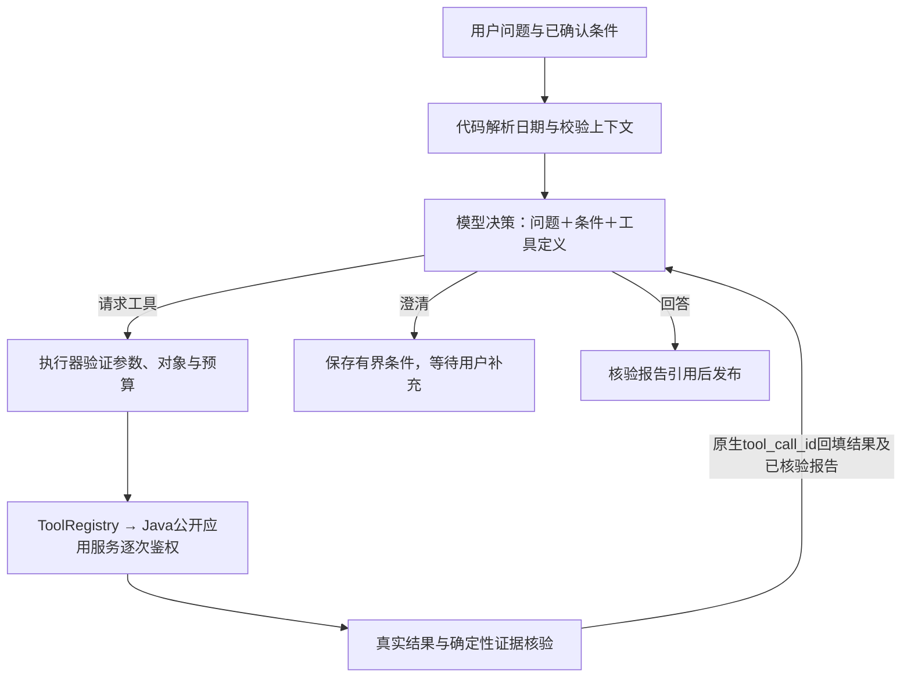

# 模型驱动的只读分析循环

2026-10-21 按用户指定切换生产决策入口。对通过认证的分析问题，每轮先将问题、必要结构化上下文及现有12个工具定义交给模型，由模型决定回答、澄清或请求工具。没有额外的固定意图分类模型，也没有规则路由兜底。没有可用模型时，库存问题和利润澄清同样明确失败。

`app.graph.SalesAgent`实际指向`ModelDrivenAgent`，LangGraph运行`Decision → Tools → Decision`。`ModelClient.decide`使用现有兼容Chat Completions接口和原生function calling，`tool_choice=auto`；一次回复可请求多个工具，执行器按顺序执行，再把每条结果以`role=tool/tool_call_id`交回同一决策模型。无需工具时一次模型请求即可澄清；查询后至少再有一次模型决策。实际次数随补查、失败及纠正变化，不固定为两次。

## 执行边界

- 工具仍为原有销售总览/趋势/安全模板、客户/商品排行/解析/单对象、库存/预警/工单缺料/待入库及操作对象解析；没有新增业务工具、自由SQL或写操作，也未升级依赖。
- LLM工具参数不接受日期和身份。日期由原有Asia/Shanghai确定性代码解析并注入；含首日、不含结束边界，自然周、最近N天含今天、等长比较沿用既定定义。内部认证与短期能力不进入模型消息。
- 后端ID只来自用户明确指定、已确认条件或本轮唯一且未截断的后端候选。重名选择须重新查询同一候选来源；已消失的选择不能被剩余唯一对象替换。显式新ID覆盖旧ID；排行中的ID不会自动获得单对象查询资格。Java仍逐次检查当前身份、权限及对象归属。
- 工具返回值经已有金额/订单/日期/单位/来源规则验证；库存行匹配请求仓库/物料，工单结果匹配工单ID。模型看到有界的业务结果、失败代码及已核验报告；超过31天的趋势在模型消息中省略逐日点，代码仍核验完整序列。
- 模型只选择本轮已核验的`reportIds`，不能直接发布自写业务数值。报告引用必须是同类报告的最新结果，并覆盖本轮明确指定的对象。相关性也由决策提示约束；这不代表可以证明任意自然语言理解正确。无效引用最多反馈纠正两次，随后明确失败。
- 故障作为工具结果回模型；失败不当零。等价安全模板补查成功按证据项消除故障，未补齐的故障不允许完整成功报告。无权限/失效授权直接终止。到达预算、时间或证据上限时显示未完成原因。

每请求最多8轮模型决策，工具次数沿用`AI_MAX_TOOL_CALLS`（默认4、最大8），修正回复最多2次；单次工具参数最多4KB、模型消息总量最多48KB，Agent总等待上限150秒，模型/工具单次请求沿用45/15秒。Java180秒、页面190秒等待上限保持。取消传播到模型/工具等待，不创建后台业务动作。

## 澄清、重试与历史

澄清JSON允许`conditions`携带白名单内已明确的指标、维度、名称查询、操作目的与后端ID，最多1600字节；日期仍只能由代码生成。缺日期时也保存已明确客户和销售指标，刷新后只补日期可继续。模型不得借conditions增加身份或未核验ID。候选列表、工具数值和整个历史不保存到上下文。

模型尚未成功识别就失败时，仅保存最多400字符、脱敏后的最近失败问题`retryRequest`供显式“重试”；它占用原context_json的4096字节预算，新问题会清除，成功后删除。它不是长期记忆。会话仍由MySQL保存并按当前用户隔离；不新增表、DDL或Checkpoint。执行用量仍只保存于本次事件/验收报告，不补造历史统计。

原`RuleWorkflow`保留既有规则、确定性报告组件与兼容性回归。生产不会执行其Planner/Reflection或操作路由，只复用报告渲染和证据计算。旧`ModelClient.plan/reflect`保留兼容组件测试，新主环路不调用它们。测试报告分别说明旧组件覆盖和新入口覆盖，模拟模型不算真实模型验证。

## 运行与验证

开发仍使用现有Start-Backend/Start-Agent/Start-Frontend脚本；正在运行的开发进程需重新加载才能采用新代码。本轮不自动重启既有开发服务。

默认`./scripts/Test-AiEvaluation.ps1`运行不访问模型的Python测试和mini_mfg_test工具集成。真实页面验收必须显式配对：`Start-AiAcceptanceAgent.ps1 -Live`和`Test-AiAcceptance.ps1 -Live`，完整启动步骤见[隔离验收](ai-page-acceptance.md)。未开启Live的验收Agent仍可用于“模型未配置”检查，但不能再演示成功的库存分析。

实际执行记录、失败及未验证项见[本次报告](ai-model-loop-report.md)。前7阶段报告保留为历史证据，不代表新架构已经自动通过那些历史Live套件。
