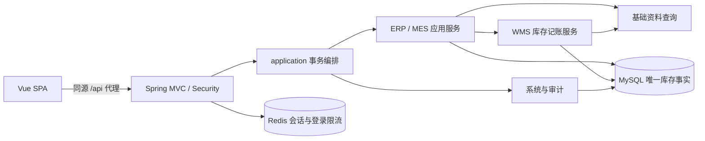

# 架构设计

## 决策

选择单个 Spring Boot 进程、单个 MySQL 数据库和独立 Vue SPA。后端一个 Maven 模块，按业务包模块化；无需 Spring Modulith 运行依赖。相较 Maven 多模块可减少初版构建与 DTO 发布成本；相较微服务无需远程事务和运维。复杂通用单据继承框架不引入，采购、工单、销售各自有明确应用服务。

独立 Maven 坐标 `io.github.lightmanufacturing:light-manufacturing-server:0.1.0`，Java 根包 `io.github.lightmanufacturing`，前端包名 `light-manufacturing-web`。数据库 `mini_mfg_dev`，测试 `mini_mfg_test`。后端本地端口 8081，前端 5173，均仅绑定回环地址。



## 目录与职责（目标结构）

第4阶段已实现system/master/erp/mes/wms及成品入库协调入口：采购/销售独立应用服务、生产完整最简状态机、WMS统一记账和查询。第5阶段已补齐真实工作台与frontend。公共审计在shared.persistence，分页/数量/动作DTO在shared.api，成功命令服务在shared.application；ActorPrincipal由会话身份实现，shared不依赖业务模块。

```text
backend/
  pom.xml, mvnw, mvnw.cmd, .mvn/wrapper/
  src/main/java/io/github/lightmanufacturing/
    application/        跨模块用例、事务、请求边界
    system/             用户、角色、固定权限、安全、操作日志
    master/             物料、客户、供应商、仓库
    erp/purchase/       采购聚合、金额计算
    erp/sales/          销售聚合、金额计算
    mes/                单层BOM、工单、用料快照、一次领料/报工及入库协调
    wms/                余额、流水、库存单据和记账
    workbench/          只读统计查询
    shared/             错误类型、时间、分页、数值值对象
  src/main/resources/db/migration/
  src/test/java/io/github/lightmanufacturing/
frontend/
  src/{api,types,router,stores,layouts,components,views,styles}/
  tests/{unit,e2e}/
  package.json, package-lock.json
docs/
infra/                  后续可选 Compose
```

业务包内部按 controller/dto/application/domain/repository 组织，文件职责小而清楚。`shared` 不依赖任何业务模块；master、system 不依赖 ERP/MES/WMS；erp、mes 可调用 WMS 公开记账服务，WMS 不回调 ERP/MES；跨模块联动由顶层 application 编排。workbench 通过公开查询或专用只读投影读取数据，不修改聚合。Repository 不跨模块暴露，不建跨模块 JPA 级联关系，用 FK ID 和明确服务调用。查询 DTO 组装在事务内完成，禁用 OSIV 和实体 JSON 序列化。

## 事务边界

顶层 public 用例方法使用 `@Transactional(rollbackFor=Exception.class)`，由 Spring 代理调用。WMS 记账方法要求 `Propagation.MANDATORY`，与业务状态和成功操作日志共用事务；不自调用绕过代理，不使用异步事件完成必须原子的业务。

| 用例 | 同事务内容 |
| --- | --- |
| 采购 receive | 锁采购头、校验状态、加全部余额、建 EXECUTED 采购入库及明细、流水、采购 RECEIVED、成功命令与审计 |
| 工单 confirm | 锁工单及当前 BOM、校验资料/数量、复制 BOM 快照、冻结仓库/计划、READY_TO_ISSUE、命令与审计 |
| 工单 issue | 锁工单、按快照锁余额、校验全部充足、全量扣料、EXECUTED 领料出库及流水、IN_PRODUCTION、命令与审计 |
| 工单 report | 锁工单、报工记录（唯一工单）、PENDING 生产入库及明细、PENDING_INBOUND、命令与审计；不写余额/流水 |
| 入库 execute | 先锁关联工单，再锁入库单、校验关联/待执行、加成品余额及流水、EXECUTED、工单 COMPLETED、命令与审计 |
| 销售 ship | 锁销售头、按顺序锁余额、全部充足后扣成品、EXECUTED 销售出库及流水、SHIPPED、命令与审计 |

草稿修改/删除、确认/取消、BOM更新均有事务和头行锁。采购/销售确认重新检查启用资料并冻结显示快照；工单确认依次锁工单、BOM、升序物料，再读锁仓库，资料停用需同一行写锁。新工单保存按仓库ID升序读锁。已有来源收发/领料/入库允许资料已停用。物料引用永久冻结code/unit，type始终不可改。

### 库存底座与第4阶段业务集成

`InventoryService.post(StockPosting)`、`prepareProductionReceipt(StockPosting)`、`execute(documentId,expectedVersion,operatorId)`均MANDATORY；从无事务环境调用即失败。公开StockPosting不可变且复制明细列表，校验1～100行、物料与来源明细不重复、整数范围及业务物料类型；操作人显示名通过system公开OperatorDirectory读取。

锁序为调用方来源头→升序物料引用锁→库存单→升序余额。物料引用锁会使同料跨仓库动作提前串行，初版以正确性优先；不假定JVM锁。库存用JdbcTemplate统一写，不建立可变库存JPA实体，JpaTransactionManager使其与来源JPA、资料标记和日志共享同一个MySQL连接事务。余额按唯一键无变化upsert并SELECT FOR UPDATE；全部明细检查成功后才更新余额、写流水和执行状态。

库存单以(kind,source_type,source_id)唯一；排序并规范化的SHA-256指纹防止同来源换内容重试。相同来源同内容返回原结果，准备PENDING生产入库不动余额。第4阶段在外层增加CommandService/command_record：来源头锁内查已成功动作，重放原operationId和当前详情；无记录才校验版本/状态并执行，所有副作用和成功审计/命令一起提交。

库存单采用source_type/source_id/source_line_id逻辑来源，第4阶段业务调用方已经锁来源、验证真实状态/冻结数量并在同事务更新来源。采购/销售通过本模块JDBC Repository访问聚合，生产头/快照/报工使用JPA，WMS统一JDBC；同DataSource/JpaTransactionManager和READ_COMMITTED共享事务，库存余额没有可陈旧JPA实体。跨模块只用公开应用服务。

`ProductionReceiptController`位于application.controller，调用MES公开executeReceipt：先读不可变库存来源，再锁真实工单；校验PRODUCTION_RECEIPT、报工行、成品仓/物料/数量，随后调用WMS执行并完成工单。WMS不回调MES，无第二个工单入库接口。report按计划量写唯一报工事实并准备PENDING单，整个事务不增加成品余额。

缺料预览调用WMS公开availableQuantities，只读、不锁余额、不预留。issue忽略历史预览，使用工单冻结快照重新整单检查并记账。动作响应不接收实际数量/状态/总金额，草稿DTO与动作DTO分开，未知字段400。金额计算在ERP Money及OrderDraftValidator执行，明确定义为人民币含税单价，不拆税/不做财务核算。

## 并发和幂等算法

1. 请求层校验会话、权限、CSRF 和 DTO。命令禁止携带实际数量。业务动作 `version` 用于首次执行前的乐观冲突提示。
2. 按统一顺序锁工单/采购/销售头；生产入库始终工单 → 库存单，禁止反序。检查 `command_record(resource_type,resource_id,action)`：已成功则返回当前单据视图和原操作 ID、replayed=true，即便版本已改变；此时仍检查当前权限。
3. 无成功记录才比较版本、状态；不合法返回 409。按 (warehouse_id,material_id) 升序确保余额行存在：同事务使用带唯一键的插入或无变化 upsert，不忽略其他约束错误；再逐行 `SELECT FOR UPDATE`。首次建零行和余额变动都在同事务中。扣减时缺行视为 0，仍保持统一锁协议。
4. 全部校验通过后写入出入库单、明细和余额/流水，扣减可额外使用 `quantity >= required` 条件更新及检查行数。批量原生 SQL 与 JPA 实体不可混用过期余额，必须 flush/clear 或统一采用一种写法。
5. 更新业务状态与 version，插入唯一成功命令记录，写成功审计，提交。唯一来源约束和非负 CHECK 再兜底。出现唯一冲突先回滚，重试通过新事务读取已提交结果，不能在已标记回滚事务中继续。
6. 锁等待/死锁整单回滚，返回可重试 409 CONCURRENT_OPERATION；不在事务中等待外部请求。客户端重试同一动作不会重复记账。

事务隔离固定 READ_COMMITTED。JPA 头使用 `@Version` + 必要的悲观写锁；库存不依赖 JVM synchronized 或 Redis 锁。事务内不调用 Redis/外部服务，避免跨资源原子性假设。数据库提交后响应丢失时，以命令记录判定成功。

## 安全、会话与日志

Spring Security + Spring Session Redis，命名空间 `light-mfg:local:session`；限流键 `light-mfg:local:login-limit:{dimension}:{sha256(normalized-value)}`，测试独立前缀。限流原子 Lua 计数与过期：用户名 5 次失败/15 分钟，IP 30 次失败/15 分钟，两者任一触顶返回 429/Retry-After；账号成功后清其失败计数，IP 计数自然过期。不信任任意 X-Forwarded-For，本地取连接 IP。Redis 故障登录/会话失败关闭并返回 503，不回退本地内存认证。

会话仅保存用户 ID 和安全上下文；每次受保护请求从数据库重新检查 enabled 与当前有效权限，使停用、改密、角色调整下一请求生效。改密使旧会话通过 authVersion 不匹配失效；登录轮换 Session ID，退出删除会话及 Cookie。权限为固定字符串，在注解中进行精确 authority 判断，无用户可编辑表达式。固定权限表用迁移同步，页面不允许创建权限点。

前端通过 Vite `/api` 代理使用同源 Cookie；生产静态站点也反代 `/api`，默认不开放跨域。登录前 GET CSRF，登录/退出后重新获取 token；写请求送 `X-CSRF-TOKEN`。本地只使用 localhost，避免与 127.0.0.1 Cookie 混用。

成功业务审计与主事务提交；失败审计在主事务回滚后由独立受控事务记录，不记录明细请求体或密码；审计写入失败不得替换原错误，Logback 输出带 traceId 的脱敏错误。认证审计独立记录。重复命令返回可记技术日志但不新增业务成功事件。Logback 按日滚动、本地 logs 不入库不提交。

Actuator 仅公开 health 的 UP/DOWN，不公开详细连接信息；其他管理端点默认关闭。OpenAPI/Swagger 仅 local profile 且要求 `system:api-docs:read`；生产默认关闭。时钟注入 Clock 便于测试。

## 部署与演示隔离

优先本机 Java17 + MySQL8 + Redis；不改系统默认 Java，通过本项目进程 JAVA_HOME 启动。后续可选 Compose 为 MySQL 8.4.7/Redis 7.4.2，候选宿主端口 13306/16379（3307/6380也已占用），命名卷 `light-mfg-*`，启动前重新检查端口；本阶段不生成或运行。连接值通过项目环境变量传入，数据库建库和授权须另行批准。Flyway 不自动创建数据库，Hibernate 仅 validate。

演示初始化只向明确授权的专用库添加固定物料/BOM/仓库/客户/供应商；交易通过 UI/API 顺序操作，不直接设置库存。生产配置不暴露初始化/清库接口。

## 验证策略

单元测试覆盖数量/密码/JSON规则；真实HTTP验证权限/CSRF；MySQL8独立测试库验证Flyway、唯一约束、回滚及独立事务并发；Redis独立实例验证会话和限流。第2、3阶段实测见各阶段verification文档。第5阶段前端类型检查、单元及真实浏览器闭环已通过；不得用H2代替MySQL。

## 第5阶段前端与工作台

frontend按路由拆分视图，共享Axios、Pinia认证、RemoteSelect和状态/金额格式化。工作台应用服务使用JdbcTemplate只读投影，库存预警调用公开StockQueryService，不访问其他模块Repository，不参与库存写事务。后端按固定read权限过滤聚合字段和明细，前端不得用分页列表拼凑总额。

## AI经营分析增量

新增ai模块：controller只转交DTO/身份；application负责会话归属、短期能力令牌、SSE逐帧代理和有界取消；ERP公开SalesAnalyticsService负责固定只读聚合，跨模块不读取ERP Repository。Java用JDK17 HttpClient，最多4并发、180秒外层超时；不将整个流缓冲后返回。

独立agent/ Python FastAPI + LangGraph，Planner/Executor/Analyzer/Reflection/Reporter/Clarification及模板TextToSQL条件节点，ToolRegistry/ToolAdapter统一受控工具。计算使用Decimal与真实SQL结果，数字不交模型运算；反思受限，Reporter确定性模板，区分规则提示与原因推测。

Java仅在启动/结束短事务落消息，模型与HTTP等待在事务外；取消持久化状态、关闭HTTP流、撤销能力。会话按服务端工厂与用户隔离，工具请求每次重验有效权限。当前工厂对应独立数据库，不改造为共享库多租户。长期记忆/完整Checkpoint等未实现边界见ai-agent-mvp.md。
## 2026-10-20本地历史导入边界

HistoricalDemoImport位于测试源，普通构建不自动执行，不注册Web接口。明确导入标志、数据库白名单、项目备份与有效operator身份检查后，按单据事务调用master/erp/mes公开应用服务，库存仍由WMS统一记账。仅本地导入进程可启用BusinessTime的非继承ThreadLocal作用域；正常调用使用系统时间/数据库UTC时间，HTTP不能控制时钟。MySQL命名锁防止同库导入并发，批次稳定备注支持事务级跳过，不新增业务工作流。

## AI客户/商品维度（2026-10-20）

AI网关通过ERP公开SalesDimensionsService执行维度查询，ERP通过Master公开SalesEntityLookupService投影检索身份，不跨模块读Repository。与总销售共享ELIGIBLE条件和UTC日界。LangGraph Dimensions分支经ToolRegistry确定性绑定范围和ID，不调用模型选择对象，也不把候选名称/ID交给模型；全厂旧规划/反思工作流保留。详见[设计与工具](ai-sales-dimensions.md)。
